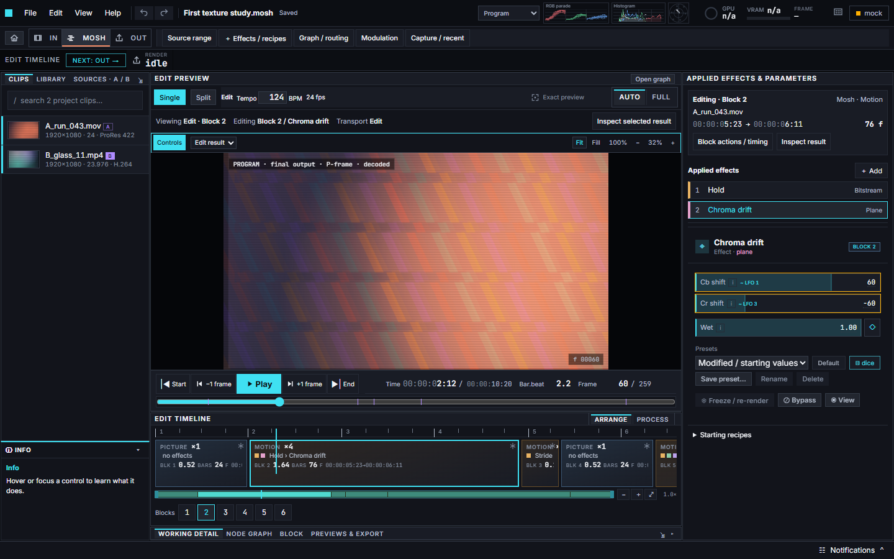
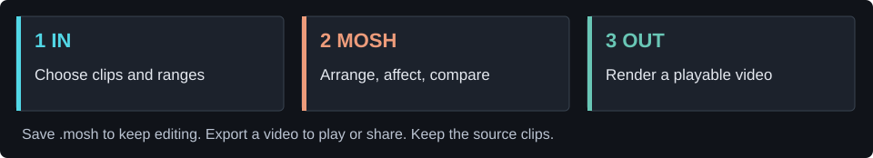
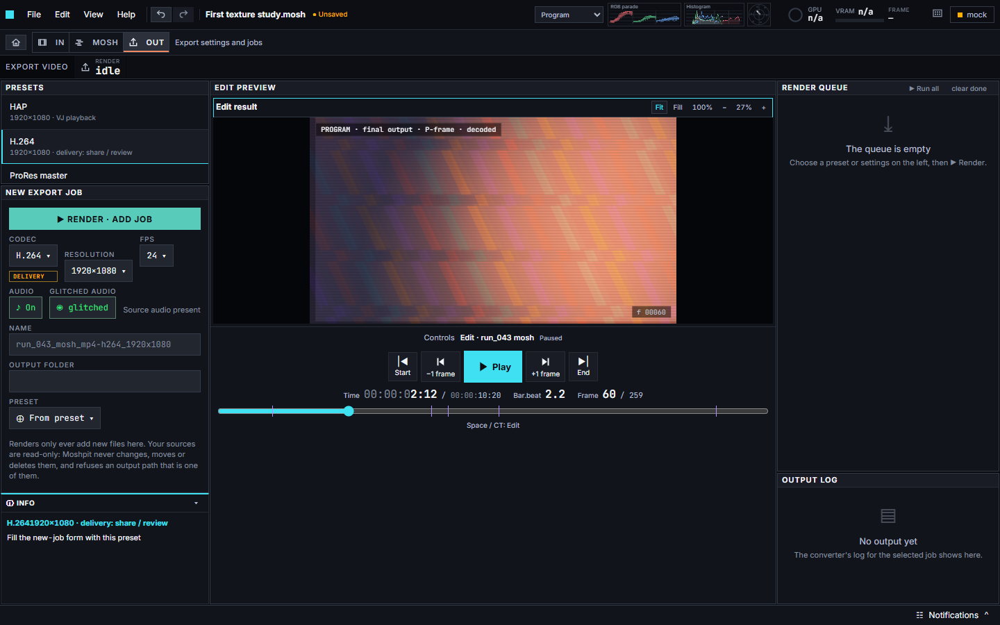

# Moshpit

**Turn clips into motion trails, broken textures and deliberate video glitches.**

A local Windows editor for arranging footage, combining effects and exporting the result. Start with a ready-made sequence; explore individual nodes when you want more control. A Loupedeck CT is optional.

[Get started](#get-moshpit) · [Make your first mosh](#make-your-first-mosh) · [User guide](docs/first-project.md) · [Help](#when-something-goes-wrong) · [Developers](docs/DEVELOPMENT.md)

Actual Moshpit interface, captured with the built-in synthetic demo. The image illustrates the workspace; it is not a render from supplied footage. Click any screenshot to enlarge it.

## Get Moshpit

| What you want | Available today |
| --- | --- |
| Read the guide and see the interface | Right here—no installation needed. |
| Run Moshpit on Windows | [Download Moshpit.exe](https://github.com/adrienwax/moshpit/releases/download/v1.0.0-rc.3-test/Moshpit.exe) — one unsigned portable test download; no installer or Sandbox required. |
| Run or modify the source | [Windows source setup](docs/DEVELOPMENT.md#run-from-source): Git, Node.js 24, npm and FFmpeg/FFprobe. |
| Latest public test | [rc3 prerelease](https://github.com/adrienwax/moshpit/releases/tag/v1.0.0-rc.3-test) · [short first-use checklist](docs/TESTING.md). |
| Stable release | Not yet accepted. Use the test release with that limitation in mind. |

**Download `Moshpit.exe`, keep it in a folder you can write to, and double-click it.** Electron, FFmpeg and FFprobe are included—no Node.js, codec-tool download or Sandbox is required. The EXE temporarily unpacks its runtime while running; settings persist in your Windows user profile. Keep using the same EXE to reopen the app.

This is an **unsigned Windows x64 prerelease**, not a signed stable release. The [release page](https://github.com/adrienwax/moshpit/releases/tag/v1.0.0-rc.3-test) records checks and known limitations. If Windows blocks it, record the warning rather than disabling protection. GitHub’s **Code → Download ZIP** is source code, not the app. Older installers remain under Releases for rollback.

The bundled FFmpeg/x264 tools use GPLv2-or-later; their [matching source and build materials](https://github.com/adrienwax/moshpit/releases/download/v1.0.0-rc.2-test/FFmpeg-krab-local-1-corresponding-source.zip) are available separately and **are not an extra runtime download**.

## Browse a ready-made project

**Coming in the rc4 candidate; not included in the rc3 download above.** Home → **Browse projects** lets you select a recorded preview, then **Open a copy** to edit the real project. Four included studies use original procedural footage, so you need no clips of your own:

| Project | Try changing |
| --- | --- |
| Replay one P-frame | Hold → Times: repeat a motion update. |
| Texture carry / clean reset | The middle block: Motion versus Picture. |
| Chroma ghost | Chroma trail → Back or Wet. |
| Breathing feedback | Modulation → Breathing trail period. |

Play in MOSH, change one control, then **Ctrl+S** to save your copy. **OUT → H.264 → Browse… → Render · Add job** creates a video to share. The examples stay unchanged. [Browse guide and media storage](docs/EXAMPLE-PROJECTS.md). Candidate checks are still separate from public release acceptance.

## Make your first mosh

Bring **three short video clips you have permission to use**, together in one folder. Moving subjects and textured backgrounds make changes easier to see. The current rc3 download needs your own clips; the upcoming example pack contains original procedural media, not personal footage.

1. **Home → Starter Mosh.** Choose that folder when asked. Wait for preparation to finish; Moshpit creates three blocks, using up to ten seconds from each clip.
2. **Press Play below the preview.** You are now in **MOSH**. The timeline is the sequence; the highlighted block is the part you are editing.
3. **Select the middle, MOTION block.** In **Applied effects & parameters**, select **Melt**. Turn **Bypass off** to enable the starter effect—it deliberately begins bypassed.
4. **Change one control, then compare.** Play from before the middle block. Try Bypass on/off; use **Edit → Undo** or **Ctrl+Z** to reverse an edit.
5. **Save the project with Ctrl+S.** Give the `.mosh` file a name. Keep the original clips where they are: the project references them.
6. **Open OUT → H.264.** Use **Browse…** beside Output folder, then **Render · Add job**. Watch the render queue for completion and open the resulting video.

You now have **two different things**: a `.mosh` project you can keep editing, and an exported video you can play or share. [The illustrated walkthrough](docs/first-project.md) explains each step and the common terms.

## Know where you are

| Area | What you do there |
| --- | --- |
| **IN** | Browse clips, preview them and choose the range to use. |
| **MOSH** | Arrange picture/motion blocks, select effects and adjust their parameters. |
| **Graph / routing** | Inspect the processing connections for more detailed editing. Start with the effects list if nodes are new to you. |
| **OUT** | Choose a codec and output folder, render, and inspect the queue. H.264 is a useful first choice for sharing. |
| **Captures**, above the MOSH monitor | Render and replay a preview in the main picture area; switch back with **Edit**. |
| **INFO**, bottom left | Hover or focus a control for its explanation. |
| **Notifications**, bottom right | Reopen messages after popups disappear; expand a message to copy its details. |

**Picture** blocks introduce a fresh image. **Motion** blocks can carry changes from earlier images. A **recipe** groups several effects; a **parameter** is a setting within one. A **conform** is a prepared working copy of imported media. [More terms and examples](docs/first-project.md#the-small-glossary).

<strong>See the export workspace</strong>

This is the same synthetic UI demonstration. A saved project is not an export, and an empty render queue means no output job has been added yet.

## When something goes wrong

| Symptom | Try this |
| --- | --- |
| Starter Mosh asks for more clips | Choose one folder with three distinct playable video files. |
| The effect seems absent | Select the intended block/effect, check Bypass, then play from before that block. |
| A reopened project has missing footage | Restore the clips to their referenced paths. Saving `.mosh` does not collect the media. |
| Import or export fails | Open Notifications and copy the error. Source builds need a suitable FFmpeg **and** FFprobe. |
| You cannot find a control | Hover it for INFO; use IN / MOSH / OUT. Older saved layouts can adopt the new arrangement through **View → Reset current layout**; the previous layout is retained. |
| A `.mosh.journal` appears beside a project | This is recovery data, not another project to open. Open the `.mosh` file; leave the journal while editing. |

[Report a bug](https://github.com/adrienwax/moshpit/issues) with your version, steps and notification details. Remove personal paths and share footage only if you have permission. Report vulnerabilities through [private security reporting](https://github.com/adrienwax/moshpit/security/advisories/new).

## Explore further

- [First-project guide](docs/first-project.md) · [Candidate test checklist](docs/TESTING.md)
- [Browse projects: included examples and your own shelf](docs/EXAMPLE-PROJECTS.md)
- [CTserver: optional Loupedeck CT control](https://github.com/adrienwax/ctserver)
- [Source setup, checks and repository map](docs/DEVELOPMENT.md) · [Windows packaging](docs/WINDOWS-PACKAGING.md)

Original code is **MIT**, copyright 2026 **ak wax**. [Dependencies](THIRD-PARTY-NOTICES.txt) and [assets](ASSET-NOTICES.txt) retain their own licences. The download bundles FFmpeg as a separate command-line tool, with its own licensing and source requirements; see [packaging](docs/WINDOWS-PACKAGING.md). [Security policy](SECURITY.md).
