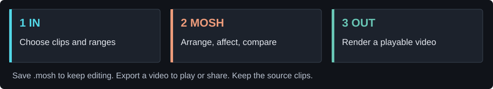
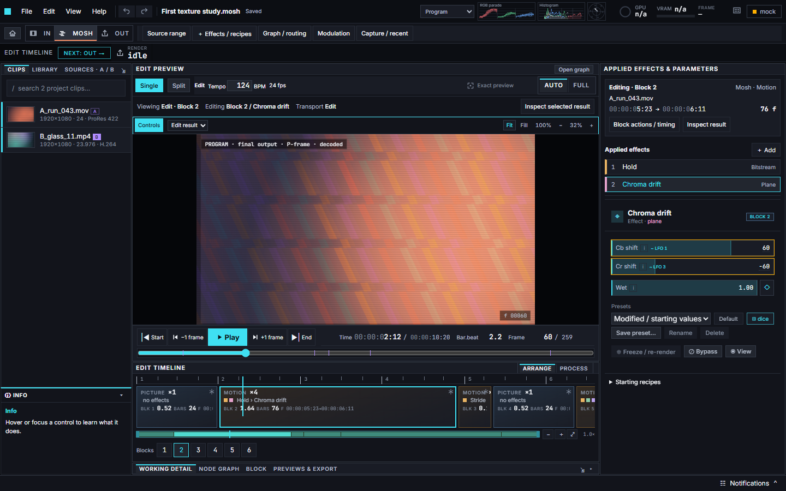
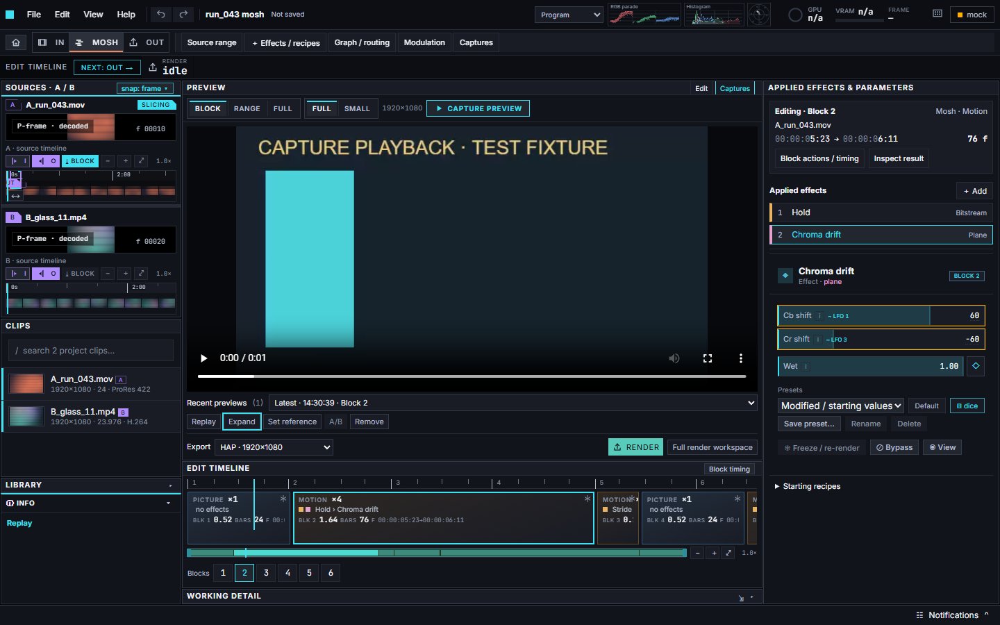
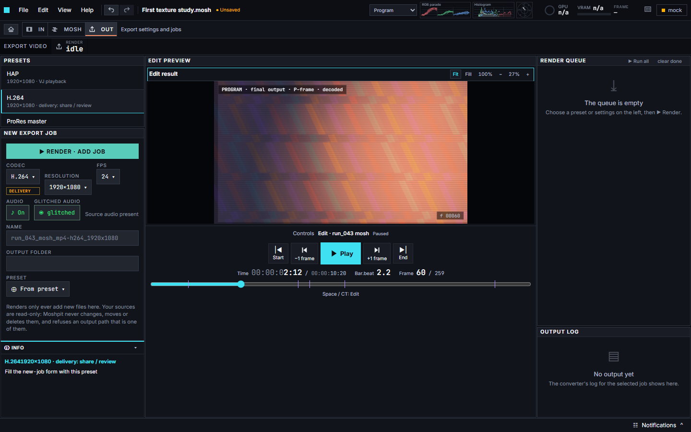

# Your first Moshpit project

[← Moshpit home](../README.md) · [Install / source setup](DEVELOPMENT.md) · [Try a candidate](TESTING.md)

**Goal:** make a short three-clip sequence, change its look, save it and export a playable video. Allow a little extra time for the first import while working copies are prepared.

## 1 · Bring three clips

Put three short videos in one folder. Use clips you own or may use. Start with ordinary H.264 MP4 footage if possible; fast movement, texture and contrasting shots make the effect easier to recognise.

Moshpit does not include the maintainer’s personal example footage. In the current public rc3 download, **Starter Mosh** builds a sequence from your files. The upcoming rc4 candidate adds **Home → Browse projects** with four original procedural examples; watch a preview, then choose **Open a copy**. See [Browse projects](EXAMPLE-PROJECTS.md) for the examples and optional local index.

## 2 · Create the starter sequence

Open **Home → Starter Mosh**, choose your folder if prompted, and wait for preparation. This imports three distinct clips and creates **picture → motion → picture**, up to ten seconds per clip. Short clips stay short. Existing unsaved work is checked before replacement.

## 3 · Read the editing workspace

Actual UI with synthetic demo content; this screenshot is a different illustrative edit, not the exact Starter Mosh result.

- **Left:** Sources A/B for choosing ranges, Clips below, and Library folded at the bottom; INFO explains the hovered control.
- **Centre:** the preview, Play/Pause, frame stepping and time/frame readouts.
- **Below:** the sequence of blocks. Click a block to make it the editing target.
- **Right:** that block’s applied effects and the selected effect’s controls.

**Space** plays/pauses the edit; when Captures is active it controls the recorded preview. Text fields and interactive menus keep their normal keyboard behaviour. The transport’s **Start**, **−1 frame**, **+1 frame** and **End** controls move the playhead. Start before a transition when comparing a temporal effect: the image may depend on what played before it.

## 4 · Enable and compare the first recipe

Select the middle **MOTION** block, then **Melt** in its applied effects. Starter Mosh adds this recipe **bypassed**; turn **Bypass off** to enable it.

Play, change one visible parameter, and compare with Bypass on/off. **Ctrl+Z** undoes the edit; **Ctrl+Shift+Z** redoes it. Keep the first experiment small so the relationship between the control and the result is obvious.

You can explore **+ Effects / recipes** later. A recipe is a prepared group of effects, not a different file format. **Graph / routing** exposes the connections when you want to inspect how the chain works.

### Compare a captured preview

Choose **Captures** above the central monitor, select Block, Range or Full, then **Capture preview**. Play the recording there, use **Replay** to restart or **Expand** for a larger view. **Edit** returns to the working preview; effects and the timeline remain accessible.

Actual UI with a synthetic playback fixture; this picture demonstrates the pane, not an exported effect result.

## 5 · Save the editable project

Press **Ctrl+S**, choose a name and location, and save the `.mosh` file. Reopen it with **File → Open** or **Ctrl+O**.

> **Project ≠ media archive.** The project stores editing decisions and references to footage. Keep those clips available. An example opened through the local example shelf becomes an unsaved copy, so saving your experiment need not replace the original example.

## 6 · Export a video

Open **OUT**, choose the **H.264** preset, use **Browse…** beside **Output folder**, and click **Render · Add job**. Rendering starts through the queue; wait for the job to complete. Open the resulting file in a video player.

Actual UI using the synthetic demonstration; no export has been queued in this screenshot.

| Output | A practical starting use |
| --- | --- |
| **H.264** | A compact video for review and sharing. |
| **ProRes** | An intermediate file for further editing; usually larger. |
| **HAP / HAP Q / HAP Alpha** | Playback workflows that specifically support Hap. Not the default choice for sending to a friend. |
| **PNG sequence** | Individual image files rather than a self-contained movie. |

Save the project **and** keep the export. Changing an export does not replace the editable project.

## 7 · Find help without losing your place

Hover or keyboard-focus a control to read **INFO** at bottom left. Open **Notifications** at bottom right for messages that have disappeared; expand an entry and use **Copy details** when reporting an error.

## The small glossary

| Term | Meaning here |
| --- | --- |
| **Frame / FPS** | One image / how many images make one second. Frame numbers depend on the project rate. |
| **Source** | A video file you bring into the project. |
| **Conform** | A working copy prepared to fit the project’s editing format. The source stays separate. |
| **Block** | One section of the sequence, with a source range and processing choices. |
| **Picture / motion** | A fresh image reference / a section that can carry changes from previous imagery. |
| **Effect / recipe** | One processing operation / a prepared group of operations. |
| **Node / graph** | An operation drawn as a box / its processing connections. |
| **Parameter / modulation** | A control value / a way of changing that value over time. |
| **Bypass** | Temporarily skip an effect without deleting it. |
| **Render / export** | Compute the finished sequence / write a playable file or image sequence. |

[Back to Moshpit](../README.md) · [Report a reproducible problem](https://github.com/adrienwax/moshpit/issues)
